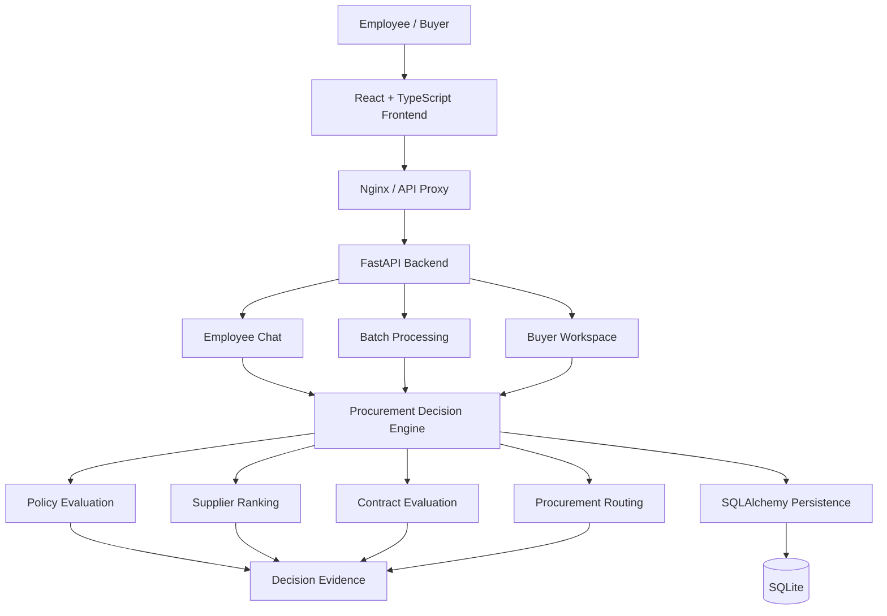
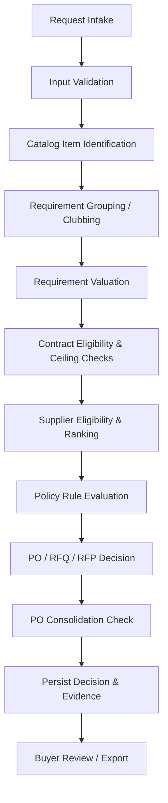

# Cantill Procurement Intelligence Platform

**Policy-driven procurement automation with explainable, deterministic decisions.**

Cantill is a procurement decision platform built for **Corvo Engineering** that transforms employee purchase requests and bulk procurement data into consistent, policy-driven decisions.

It combines conversational request intake, CSV batch processing, supplier evaluation, contract validation, policy version management, procurement routing, and buyer review in a unified application.

---

## Live Demo

| Service | Link |
|---|---|
| 🌐 Application | https://procureflow-policy-driven-procurement-v5qr.onrender.com |
| ⚙️ Backend API | https://procureflow-policy-driven-procurement.onrender.com |
| ❤️ API Health | https://procureflow-policy-driven-procurement.onrender.com/api/health |
| 💻 GitHub Repository | https://github.com/gongatinaresh/ProcureFlow-Policy-Driven-Procurement-Automation-Decision-Engine |

> The application is hosted on Render. Free-tier instances may experience cold-start delays after inactivity.

---

## Overview

Procurement decisions involve more than selecting a supplier. They require evaluating purchasing history, item availability, contract terms, supplier eligibility, spending limits, urgency, policy requirements, and consolidation opportunities.

Cantill centralizes these evaluations in a structured backend decision engine to make procurement outcomes consistent, traceable, and explainable.

### Key Features

- Conversational employee purchase-request intake
- Catalog matching and request clarification
- CSV-based bulk purchase request processing
- Row-level validation and error reporting
- Deterministic policy evaluation
- Requirement grouping and consolidation
- Contract eligibility and spending-ceiling validation
- Supplier eligibility and ranking
- Procurement routing: PO, RFQ, and RFP
- Buyer decision workspace
- Policy amendments and version management
- Contract PDF upload and text extraction
- Decision evidence and audit records
- CSV export of procurement outcomes

---

## Application Modules

### 1. Employee Procurement Chat

Employees can create purchase requests through a guided conversational workflow.

The chat collects required information, identifies potential catalog matches, requests clarification when information is missing, and allows the employee to review the requirement before submission.

<details>
<summary>Capabilities</summary>

- Item identification and catalog matching
- Quantity collection
- Plant selection
- Required delivery date
- Urgency
- Request clarification
- Catalog alternatives
- New-item handling
- Request confirmation before submission

</details>

The conversational workflow uses implemented application logic. An external LLM is not required for request intake or catalog matching.

### 2. Batch Processing

Procurement teams can upload purchase-request CSV files and process multiple requirements through the decision engine.

The batch pipeline validates the input and evaluates eligible rows using the applicable procurement policy.

**Processing capabilities:**

- CSV schema validation
- Row-level validation
- Duplicate request handling
- Item and plant validation
- Missing-information checks
- Policy-based evaluation
- Batch decision persistence
- Row-level outcomes and errors
- Exportable processing results

Invalid or unsupported records are reported with explicit reasons rather than silently treated as successful procurement decisions.

### 3. Procurement Decision Engine

The decision engine evaluates procurement requirements using structured policy data and backend business logic.

It supports:

- Item matching
- Requirement clubbing
- Requirement valuation
- Contract eligibility
- Contract price selection
- Contract ceiling checks
- Supplier eligibility
- Supplier ranking
- Procurement route selection
- PO consolidation
- Policy clause evidence

The decision engine is designed to be independent of the frontend and request-intake method, allowing conversational and batch requests to share the same procurement logic.

### 4. Buyer Workspace

The buyer workspace provides visibility into procurement requirements, evaluation results, and decision evidence.

Buyers can review:

- Requirement details
- Source purchase-request lines
- Quantities and valuations
- Selected suppliers
- Contract information
- Procurement routes
- Applicable policy clauses
- Decision explanations
- Supporting procurement history

Buyer approvals and overrides are supported where implemented, with override reasons retained as evidence.

### 5. Supplier Ranking

Supplier ranking uses deterministic logic based on available supplier and procurement-history evidence.

Ranking factors include:

- Purchase frequency
- Purchase recency
- Contract evidence
- On-time delivery
- Quality rating

The ranking rationale and weights are documented in `DECISIONS.md`.

Preferred supplier outputs include ranked suppliers and a `top_three` indicator identifying the first three positions.

### 6. Contract Management

The contract register supports contract-based procurement evaluation.

Features include:

- Contract records
- Contract line items
- Supplier and item associations
- Contract validity checks
- Contract pricing evaluation
- Contract ceiling evaluation
- PDF uploads
- Local PDF text extraction
- Contract evidence in procurement decisions

Uploaded contract documents use local text extraction. Extracted information requires review and validation; contract activation or approval is not automatically performed by AI.

### 7. Policy Management

Procurement behavior is driven by structured, versioned policy data.

The policy management workflow supports:

- Policy versions
- Effective dates
- Policy amendments
- Draft and validation workflows
- Structured rule editing
- Validation of supported conditions and outcomes
- Approval workflow
- Policy history
- Policy evidence in decision outputs

Supported policy amendments can change procurement outcomes without modifying decision-engine source code.

Unsupported rule types require deliberate implementation rather than being silently interpreted as executable.

---

## Technology Stack

| Layer | Technology | Purpose |
|---|---|---|
| Frontend | React | User interface |
| Language | TypeScript | Type-safe frontend development |
| Build tool | Vite | Development and production builds |
| Backend | Python, FastAPI | API and application services |
| Database | SQLite | Application persistence |
| ORM | SQLAlchemy | Database access and models |
| Migrations | Alembic | Schema migration management |
| Validation | Pydantic | API and structured policy validation |
| Data processing | Pandas | Batch processing and CSV export |
| PDF processing | PyMuPDF | Local PDF text extraction |
| Testing | Pytest | Backend testing |
| Containers | Docker | Application packaging |
| Orchestration | Docker Compose | Local multi-service deployment |
| Web server | Nginx | Frontend hosting and API proxying |
| Hosting | Render | Public deployment |

---

## Architecture



The frontend communicates with the FastAPI backend through API endpoints. In the containerized environment, Nginx serves the frontend and proxies API requests to the backend.

The procurement decision engine is separated from the intake interface so that employee chat and bulk processing can use the same evaluation pipeline.

---

## Procurement Decision Workflow



Each procurement decision is evaluated using structured inputs, the applicable policy version, and available procurement evidence.

---

## Project Structure

```text
ProcureFlow-Policy-Driven-Procurement-Automation-Decision-Engine/
│
├── backend/
│   ├── app/
│   │   ├── main.py
│   │   ├── policies/
│   │   ├── models/
│   │   ├── schemas/
│   │   ├── services/
│   │   └── ...
│   ├── tests/
│   ├── alembic/
│   ├── requirements.txt
│   └── ...
│
├── frontend/
│   ├── src/
│   ├── public/
│   ├── package.json
│   └── ...
│
├── docker-compose.yml
├── .gitignore
├── README.md
├── APPROACH.md
├── ARCHITECTURE.md
├── DECISIONS.md
├── IMPLEMENTATION_PLAN.md
└── REQUIREMENTS.md
```

*The project tree is simplified for readability.*

---

## Getting Started

### Prerequisites

- Git
- Docker Desktop
- Docker Compose

Ensure Docker Desktop is running before starting the application.

### Clone the Repository

```bash
git clone https://github.com/gongatinaresh/ProcureFlow-Policy-Driven-Procurement-Automation-Decision-Engine.git

cd ProcureFlow-Policy-Driven-Procurement-Automation-Decision-Engine
```

### Start the Application

```bash
docker compose up --build -d
```

### Access the Application

| Service | URL |
|---|---|
| Frontend | http://localhost:8081 |
| API Health Check | http://localhost:8081/api/health |

### Verify Backend Health

```bash
curl http://localhost:8081/api/health
```

Expected response:

```json
{
  "status": "ok",
  "database": "ok",
  "service": "Cantill Procurement API"
}
```

### Stop the Application

```bash
docker compose down
```

Application data is stored in the Docker-managed persistent volume configured by the Compose setup.

---

## API

### Health Check

```http
GET /api/health
```

Checks application and database health.

### Batch Processing

```http
POST /api/process-batch
```

Processes procurement batch data using the configured policy and decision pipeline.

The endpoint validates uploaded data and returns processing outcomes, decision information, and row-level errors where applicable.

### Batch Exports

Processed procurement data can be exported through the application's CSV export functionality.

Refer to the backend API implementation for exact request schemas, response fields, and available endpoints.

---

## Testing

The backend test suite covers policy evaluation, procurement decision behavior, API processing, and policy management.

Run tests from the backend directory:

```bash
cd backend
pytest -v
```

### Verified Development Checks

| Check | Result |
|---|---|
| Backend test suite | 59 passed |
| Frontend TypeScript build | Passed |
| Frontend production build | Passed |
| Docker Compose configuration validation | Passed |
| Docker image build | Passed |
| Docker services startup | Passed |
| Frontend HTTP response | 200 OK |
| API health check | 200 OK |

These checks were verified during development. Re-run them when making subsequent code changes.

---

## Documentation

| Document | Description |
|---|---|
| `APPROACH.md` | Implementation approach, technology choices, AI usage, and boundaries |
| `ARCHITECTURE.md` | System architecture and component responsibilities |
| `DECISIONS.md` | Policy interpretations, assumptions, supplier ranking rationale, edge cases, and reconciliation |
| `IMPLEMENTATION_PLAN.md` | Implementation planning and work breakdown |
| `REQUIREMENTS.md` | Project requirements and challenge scope |

The platform is designed to make procurement decisions inspectable through policy clauses, contract evidence, supplier evidence, and decision rationale.

---

## AI Usage Disclosure

AI tools were used as development assistance during implementation, including code generation, debugging, documentation assistance, and review.

The deployed application does not require an external AI provider and has no configured LLM integration.

Procurement outcomes are generated by deterministic backend logic and structured policy data rather than external model-generated decisions.

---

## Deployment

The project supports local deployment through Docker Compose and has a publicly hosted deployment.

| Service | URL |
|---|---|
| Frontend | https://procureflow-policy-driven-procurement-v5qr.onrender.com |
| Backend | https://procureflow-policy-driven-procurement.onrender.com |
| Health | https://procureflow-policy-driven-procurement.onrender.com/api/health |

---

## Security & Production Considerations

Cantill is a procurement-system prototype built for an implementation challenge, not a production-ready enterprise procurement platform.

### Known Limitations

- Authentication is not implemented.
- Role enforcement is not implemented.
- Actor IDs are audit labels supplied by the UI, not verified identities.
- Contract PDFs use configured local storage.
- Scanned PDFs do not have OCR support.
- Policy activation is lazy rather than scheduler-driven.
- Policy amendments are limited to the supported structured rule schema.
- External AI integration is not configured.

### Production Hardening Requirements

A production deployment would require additional measures, including:

- Secure authentication
- Role-based authorization
- Identity verification
- Durable document storage
- Database backups and recovery
- Monitoring and alerting
- Secure secrets management
- Access controls
- Audit and retention policies

These limitations are documented explicitly rather than presented as implemented capabilities.

---

## Design Principles

- **Policy over hardcoded outcomes** — procurement decisions are driven by structured policy data.
- **Deterministic decisions** — the same inputs and policy version should produce reproducible outcomes.
- **Explainability** — decisions expose relevant evidence and policy rationale.
- **Validation first** — unsupported and incomplete data should not silently pass.
- **Separation of concerns** — frontend, intake, policy evaluation, supplier ranking, and persistence are separated.
- **Auditable changes** — policy versions, approvals, and overrides retain traceable evidence.
- **Honest AI boundaries** — external AI is not used to generate procurement outcomes.
- **Reproducibility** — batch runs and decisions remain traceable to inputs and policy versions.

---

## License

This repository was created as a full-stack procurement system implementation challenge.

Refer to the repository owner for licensing and reuse permissions.
